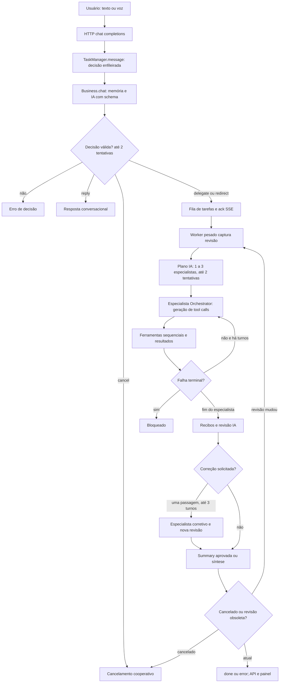

# 02 — Harness e loops

Referências completas: [EVIDENCIAS.md](EVIDENCIAS.md), E03–E11, E32. Data: 2026-10-08. Fluxo principal examinado: Business Python com streaming e mailbox.

## Fluxo executável



**CONFIRMADO:** mistura máquina de estados de tarefas, planejamento dinâmico por IA, function calling e Observe–Act–Verify. O plano contém papéis/objetivos, não uma sequência determinística completa de cliques. Os papéis `pesquisa/vendas/fiscal/operacoes` configuram novas instâncias de Orchestrator com prompts, não processos independentes. ReAct e outros padrões existem em agentes alternativos; não atribuí-los automaticamente ao caminho Business. E05, E07–E11.

## Pseudocódigo equivalente

```text
message(session, texto):
  sinaliza cancelamento da decisão pendente anterior
  enfileira decisão no worker conversacional único
converse:
  monta histórico user/assistant e estado disponível
  chat: IA decide reply/delegate/redirect/cancel (até 2 formatos)
  aplica decisão sob lock; publica ack
work:
  retira tarefa da fila; captura revisão; cria controle
  executa pedido original e complementos desde o início
  se cancelada: descarta resultado
  se revisão mudou: reinicia fluxo completo
  se TaskInterrupted sem cancelamento/close: reinicia
  senão publica resultado/erro
business_run:
  extrai memória se ainda não processada
  planeja (até 2 chamadas, 1–3 especialistas)
  para especialista: gera decisões e executa ferramentas até turn_budget
  se exige execução e não tem recibo: retorna unverified
  revisa resultados por IA
  se revisão pede correção: um especialista de até 3 turnos, revisa de novo
  se summary aprovada: reutiliza
  senão sintetiza; se execução não confirmada: retorna attempted/error
```

E06 `message/_converse/_work:116–205,336–411`; E07 `_run:529–668`. O retorno de síntese também pode falhar por timeout, backend ou saída inválida; ocorrência no incidente específico não verificada.

## Limites e ausência de progresso

| Mecanismo | Implementação confirmada | Limite da garantia |
|---|---|---|
| Decisão/planejamento | Máximo2 tentativas por schema | Validação de formato não prova intenção correta |
| Plano | 1–3 especialistas | Cada especialista pode executar várias ferramentas por turno |
| Especialista | 1–12 turnos; padrão6 | Não equivale a 12 ações ou 12 inferências totais |
| Correção | Uma passagem de até3 turnos | Pode repetir efeitos anteriores |
| Continuação de saída truncada | Até2 gerações adicionais | Fora da contagem normal de turnos |
| Fila/histórico | 50 pendentes,20 complementos/tarefa;100 concluídas,50 decisões | Estado em RAM; não é deadline global |
| LoopGuard | hash de chamada, polling, ping-pong quando habilitado | Não mede resultado de negócio nem progresso visual |
| Ferramenta | Timeout no executor | Trabalho iniciado não é terminado pelo Future.cancel |

E06–E09, E32. **NÃO ENCONTRADO:** orçamento global único de segundos/tokens/inferências para uma tarefa Business, nem comparação determinística da estratégia com o estado visual anterior.

**CONFIRMADO — diferença de guard:** function calling chama `check_call` se recebeu `_loop_guard`; structured só comprime contexto, sem essa checagem. Business não passa configuração explícita, mas `ToolUsingAgent.__init__:462–474` cria automaticamente LoopGuard com configuração padrão habilitada (salvo ImportError); portanto o guard existe por herança no caminho Business. O fallback Python usa a string de motivo como chave de aviso; o contador crescente de chamadas idênticas muda o motivo, podendo permitir avisos sucessivos. Rust conta/hash e polling diferentemente. **NÃO VERIFICADO:** qual bridge está carregada em outros caminhos locais. E08–E11. Não chamar o fluxo inteiro de ilimitado: existem limites de turnos, embora não cubram tempo global/reinícios.

## Ações, confirmação e interrupção

Quem escolhe próxima ferramenta é o especialista; `computer_step` chama TEMP antes de sua ação. Observação nativa AX/screenshot sozinha não precisa de IA; invocar `computer_step` para escolher `observe` ainda faz uma inferência TEMP. A primitiva `navigate` contém vários movimentos/teclas/polls determinísticos depois da escolha única do TEMP. Não há novo planejador global a cada clique. E12–E15.

**CONFIRMADO:** `requires_execution` exige algum recibo bem-sucedido, inclusive move/key/scroll. Não prova cumprimento de todo objetivo; a revisão IA recebe apenas quatro observações por especialista,800 caracteres cada e resposta2000. `reply` com requires_executionFalse também não prova ausência de alegação falsa. E07 `_run:609–664`.

Cancelamento é cooperativo antes/depois de inferência e fronteiras de ferramenta; não interrompe geração já em andamento. Redirect incrementa revisão e reexecuta desde o início; efeitos físicos anteriores não são desfeitos. **INFERIDO:** uma gravação/click pode se duplicar após retomada, sem chave de idempotência encontrada. **CONFIRMADO:** reinício do servidor não reconstrói tarefas do journal. E06, E07, E32.

Locais precisos de repetição sem informação nova: erro de `chrome_view` antes do TEMP retorna ao especialista; nova tentativa pode falhar no mesmo guard; retorno de ferramenta genérica permite nova chamada; structured não aplica check_call; aviso Python pode mudar chave; `_work` reinicia em TaskInterrupted sem exigir nova revisão. Estes mecanismos são distintos e não foram todos demonstrados no incidente102s.
