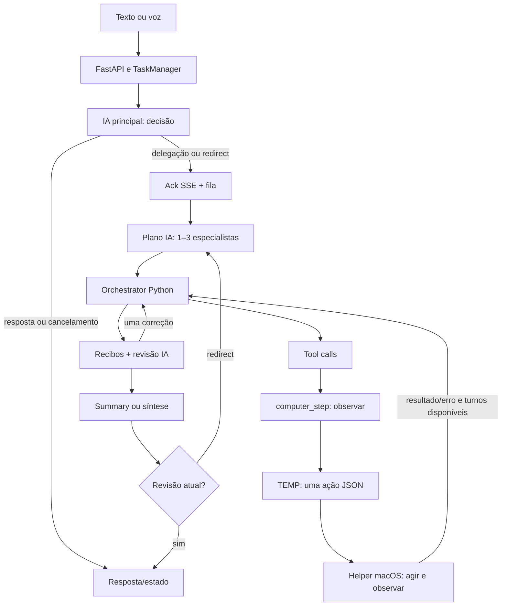

# 08 — Resumo para o próximo arquiteto

Data:2026-10-08. Auditoria de implementação, sem evolução do produto. [Evidências](EVIDENCIAS.md), [riscos detalhados](06-FALHAS-E-RISCOS.md), [limites da validação](07-TESTES-E-OBSERVABILIDADE.md). Este documento inteiro foi mantido abaixo de1500 palavras.

## Arquitetura atual

**CONFIRMADO:** frontend React/Vite chama FastAPI. No Business streaming, TaskManager executa uma decisão conversacional por IA e devolve ack sem esperar a tarefa pesada. Um segundo worker executa plano IA com1–3 especialistas sequenciais. Cada especialista é nova instância de Orchestrator Python, com mesmo engine/modelo principal e prompt de papel; ele gera tool calls, executa ferramentas e recebe resultados até limite de turnos. Revisor IA avalia observações recortadas, pode pedir uma correção de até3 turnos e aprovar summary. Sem summary aprovada há síntese adicional. Fila e estado operacional residem em RAM. E03–E08.

**CONFIRMADO:** computer_step aceita Chrome/Numbers/Excel/Finder. DesktopSessions usa AppleScript para ID de janela/URL/título/bounds e helper Objective-C para Accessibility, screenshot monitor1 e eventos CoreGraphics. TEMP recebe dois messages novos, imagem/nós e instrução; escolhe uma ação. Navegação, mouse/teclas/polling depois dessa escolha são determinísticos. Não é um plugin obrigatório do Chrome nem automação que dispense inferência. E12–E15.

Business desktop exclui ferramentas Playwright; este último abre Chromium com perfil próprio, não Chrome pessoal. Lease controla janela, sem ID estável de aba. Navigate cria nova guia e confirma host/path/query; menus exigem exploração visual/AX. O runtime.sh lido define9Bprincipal/4BTEMP, mas estado dos processos/modelos/binários atuais não foi consultado. UI seleciona modelo principal; voz captura escolha ao iniciar. E14,E17,E27.

Memória Business é Markdown Obsidian por default, SQLite por sufixo explícito; grava citações do usuário e recupera lexicalmente com relações. Não aprende automaticamente navegação/procedimento. FactStore/FAISS, skills, recipes, learning e checkpoints existem na plataforma, mas wiring completo ao mailbox Business não foi encontrado. Skills mineradas serializam argumentos vazios. JSONL registra estrutura/timing/tokens/erros, sem reconstituir contexto nem recuperar fila. E18–E24.

Rust é implementação paralela acessível por PyO3; Business usa Orchestrator Python. Orchestrator Rust atualmente faz uma chamada sem despacho de tools; outros agentes Rust têm loops. Não declarar toda crate legado, nem assumir execução Rust por arquivo aberto no IDE. E10–E11.

## Preservar e revisar

Preservar: helper físico já implementado, preflight TCC/eventos, validação de coordenadas/app, confirmação de URL, contexto TEMP descartável, decisão/planos com schemas, wrappers de recibos, separação conversa/fila, painel de etapas e journal sanitizado, Obsidian com provenance/escrita atômica, contratos de tools/engines, mecanismos genéricos de segurança e avaliações. São bases úteis, não prova de confiabilidade completa.

Revisar: autorização através de wrappers, gate de ação sensível, identidade/estado da aba, guard/transições/efeitos parciais, controle de repetição e orçamento agregado, suficiência de recibos, fronteiras de cancelamento, retomada/idempotência, memória procedural e integração dos traces. Não substituir prematuramente engines/skills/Rust sem contratos comparados.

## Quinze prioridades

Cada ID tem evidência, impacto, reprodução segura/confiança e direção geral em06.

| ID | Prioridade | Problema |
|---|---|---|
| F01 | P0 | Wrappers de desktop/planilha perdem piso de capability |
| F02 | P0 | Ação sensível tem orientação por prompt, sem gate obrigatório |
| F03 | P1 | window_changed repetido sem recuperação determinística |
| F04 | P1 | Guard rígido rejeita transição e perde sucesso parcial |
| F05 | P1 | Conteúdo web observado via desktop escapa scanner non-local |
| F06 | P1 | Timeout/cancelamento não garantem término imediato de efeito |
| F07 | P1 | Algum recibo não comprova objetivo completo |
| F08 | P1 | Navegação validada não vira procedimento Business reutilizável |
| F09 | P1 | Inferências em várias camadas, sem orçamento agregado |
| F10 | P1 | Redirect reexecuta sem checkpoint/idempotência |
| F11 | P1 | Journal não restaura fila nem explica toda decisão |
| F12 | P2 | Guard difere por modo/backend; aviso Python muda de chave |
| F13 | P2 | Lease sem aba estável; nova guia/redirect frágil |
| F14 | P2 | Revisor recorta evidência; facts system não chegam ao principal |
| F15 | P2 | Trace opcional pode persistir dados omitidos pelo journal |

P0 indica risco potencial de ação indevida, não incidente de ataque demonstrado. Não houve execução ofensiva.

## Extensões e modelos pequenos

Pontos disponíveis: registries de engines/agentes/tools; ToolSpec/ToolExecutor; DesktopSessions/ComputerStepTool; TaskControl/EventBus/TraceStore; SkillManager/recipes; Obsidian/FactStore/vector; AgenticRunner/scorers. Integrações genéricas podem ser aproveitadas, mas invariantes precisam atravessar wrappers e caminhos HTTP diferentes.

4B/9B precisam escolher parâmetros, interpretar visão/AX parcial, administrar contexto e avaliar evidência. Cadeia decisão+plano+especialista+TEMP+revisor aumenta latência mesmo para clique simples. TEMP fresco perde memória de estratégia; MAIN acumula resultados. Maior modelo não corrige determinismo/autorização/leases. Limitações de precisão são inferidas, ranking exige benchmark; nenhuma comparação quantitativa nova foi rodada. Keepalive5m é solicitação Ollama, não garantia física sob pressão. E07,E13,E25–E30.

## Janela mudou: o que sabemos

**CONFIRMADO:** título/bounds/correspondência geram window_changed; UI agrega causas. Código não encerra esse erro como terminal. Journal local contém tarefa102,0s,12calls,11falhas: primeira falha após click retornar, dez seguintes na observação antesTEMP. Portanto não foram necessariamente11 cliques. **INFERIDO:** transição legítima, popup/foco ou snapshot AX/AppleScript inconsistente explicam mecanismos possíveis. **NÃO VERIFICADO:** subcausa, domínio/menu e correlação inequívoca com Central de Vendedores. Faltam motivo específico/identidade de aba/estado antes-depois redigidos. E13–E15,E26;06.

## Perguntas abertas

- Qual branch/backend/bridge/binário e ambiente estão efetivamente carregados?
- Quais comparações de janela falharam no102s e houve sucesso parcial?
- Qual política está ativa e como ela se comporta nos wrappers específicos?
- Qual throughput/precisão/custo por etapa4Bvs9B em fixtures iguais?
- Quais traces e dados são persistidos com a configuração efetiva?
- Que critérios de pós-condição e autorização definem sucesso em interfaces desconhecidas?
- Como preservar experiência verificável e retomar sem duplicar efeitos?

São perguntas para fechar evidência/projetar a próxima etapa, não bloqueios escondidos da auditoria.

## Arquivos fundamentais

`src/openjarvis/agents/business.py`, `task_runtime.py`, `orchestrator.py`, `loop_guard.py`, `obsidian_memory.py`; `server/routes.py`, `business_tasks.py`, `local_call.py`; `tools/mac_desktop.py`, `_stubs.py`, `browser.py`; `scripts/local/mac-control/control.m`; `engine/ollama.py`, `multi.py`, `_openai_compat.py`; `security/capabilities.py`, `runtime.py`; `traces/collector.py`; `skills/manager.py`; `system/builder.py`; `learning/agents/skill_discovery.py`; `rust/crates/openjarvis-agents/src/orchestrator.rs`; frontend BusinessTasksPanel/InputArea/LocalCallPanel. O índice liga símbolos/linhas e dependências às afirmações para que outro arquiteto possa verificá-las.
